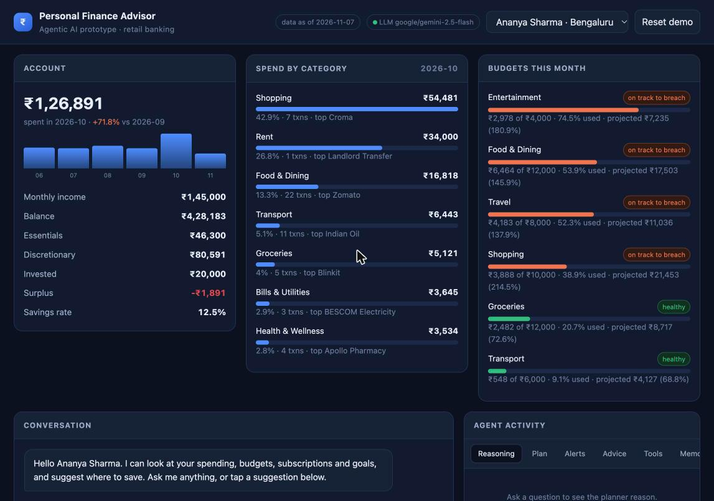
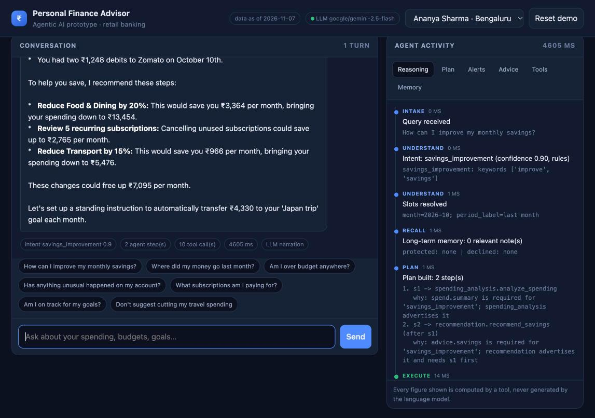
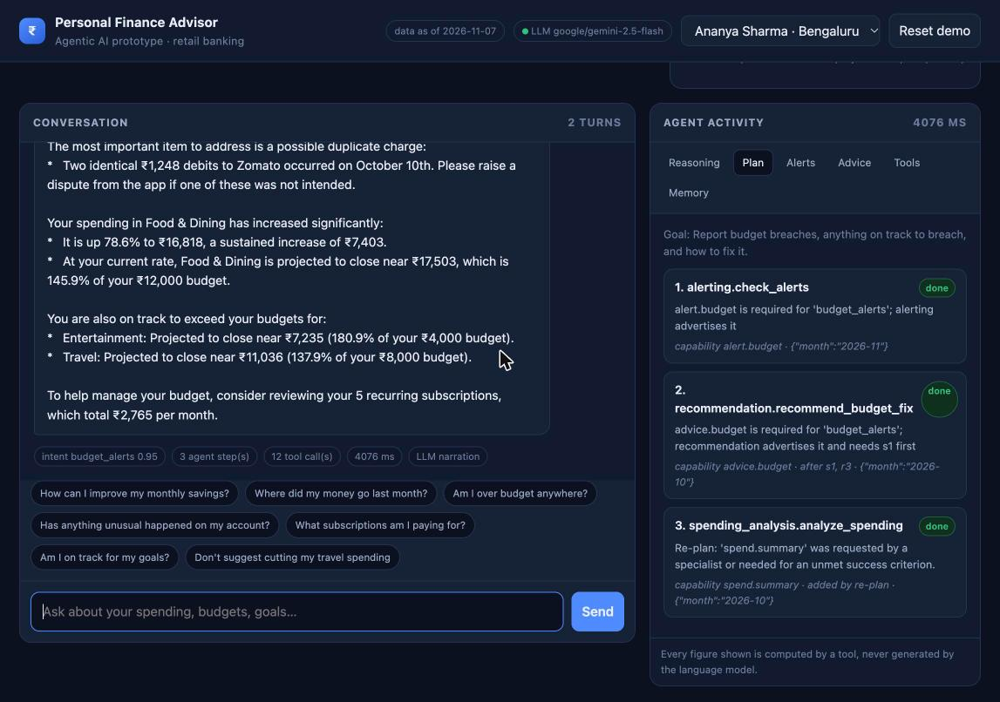
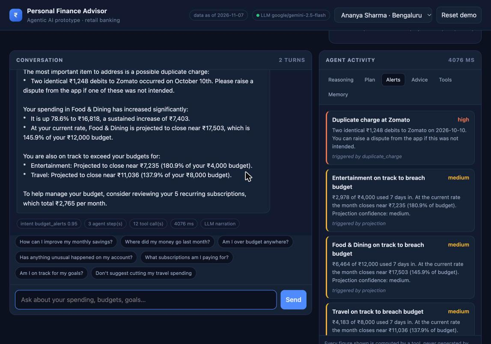
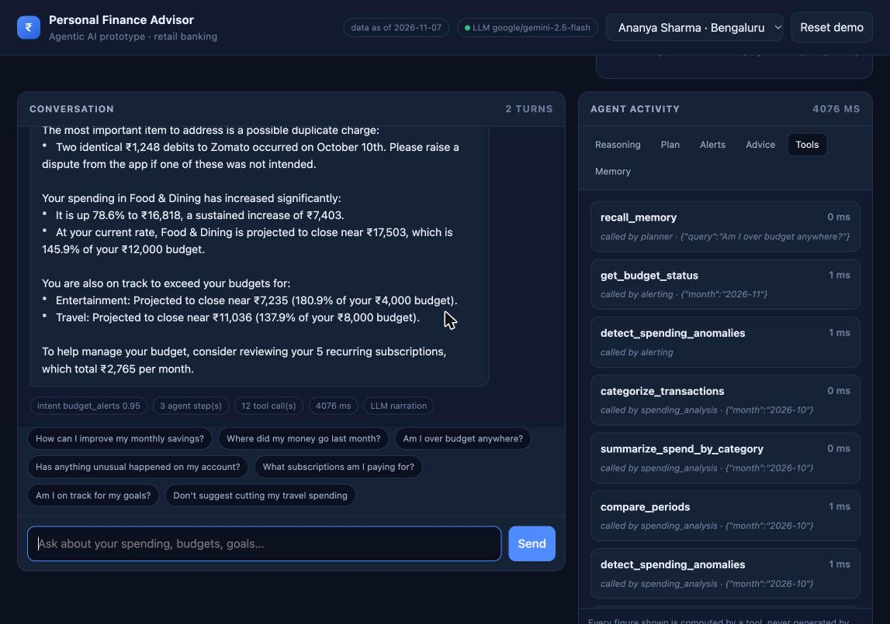
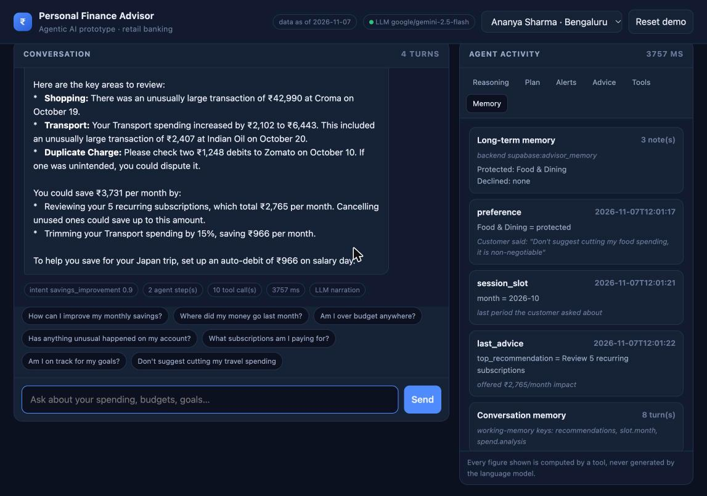
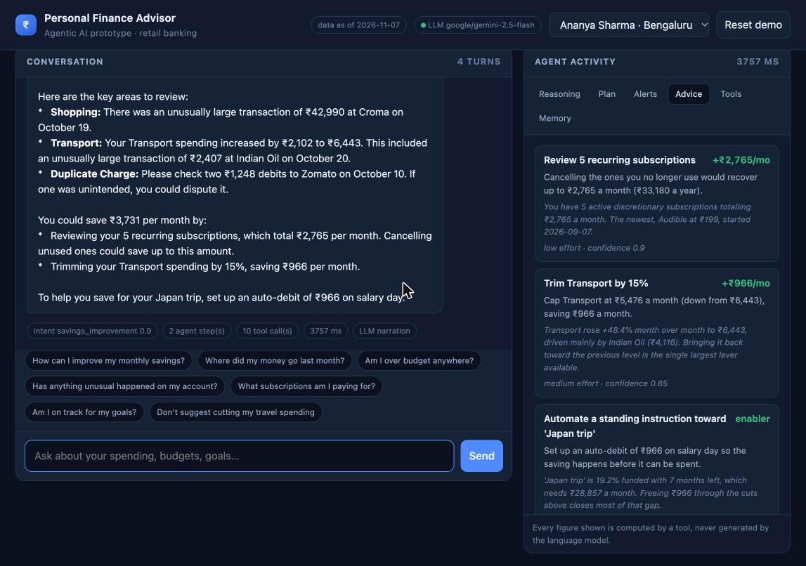

# Personal Finance Advisor Agent

An agentic AI prototype for retail banking. A **Planner Agent** interprets a
customer's question, selects specialist agents by capability, runs them in
dependency order, checks whether the evidence it gathered actually answers the
question, re-plans when it does not, and composes one grounded reply.

All four agents from the brief are implemented. The Planner is the agent built
in depth.

```
You: How can I improve my monthly savings?

[    2ms] UNDERSTAND  Intent: savings_improvement (confidence 0.90, rules)
[    2ms] RECALL      Long-term memory: 1 relevant note(s)
                      protected: Travel | declined: none
[    2ms] PLAN        Plan built: 2 step(s)
                      1. s1 -> spending_analysis.analyze_spending
                      2. s2 -> recommendation.recommend_savings  (after s1)
[    7ms] EXECUTE     s1: spending_analysis.analyze_spending -> ok
[   11ms] EXECUTE     s2: recommendation.recommend_savings -> ok
                      - Skipped Shopping: the increase is a one-off ₹42,990
                        purchase at Croma, not a habit.
                      - Skipped Travel: customer marked it protected.
[   11ms] REFLECT     Success criteria satisfied
[   11ms] SYNTHESIZE  Merged 13 finding(s), 0 alert(s), 4 recommendation(s)
[   11ms] REMEMBER    Wrote 2 note(s) to long-term memory
```

## Screenshots

| | |
|---|---|
|  **Account overview** — 6-month trend, categories, budgets with month-end projections |  **Answer + live reasoning trace** — every stage the planner went through |
|  **Re-planning** — step 3 added mid-turn after an agent declared an unmet need |  **Alerts** — ranked by severity, projections state their own confidence |
|  **Tool calls** — caller, arguments and latency for every call |  **Memory** — the preference stored in the customer's own words |



*The same savings question after the customer said food spending is
non-negotiable: the ₹3,364 Food & Dining cut is gone and subscriptions now
lead the advice.* More in [docs/screenshots](docs/screenshots/README.md).

## What this demonstrates

| Requirement | Where it lives |
|---|---|
| Multi-agent architecture | `advisor/agents/` — planner + 3 specialists, each a replaceable unit |
| Agent orchestration | `planner.py` — capability routing, dependency ordering, plan validation |
| Autonomous reasoning | reflect / re-plan loop: agents declare `unmet_needs`, the planner fills them |
| Tool / function calling | `tools.py` — 14 JSON-Schema tools, validated, timed and traced |
| Memory handling | `memory.py` — conversation, working and durable profile tiers |
| Personalised recommendations | `recommendation.py` — quantified by simulation, constrained by memory |
| Conversational interaction | web UI + CLI, with follow-ups resolved against the conversation |

## Architecture

```
                        ┌──────────────────────────────┐
   web UI / CLI ───────▶ │        PLANNER AGENT         │
                        │  understand → recall → plan  │
                        │  → execute → reflect →       │
                        │     synthesize → remember    │
                        └──────┬───────────────┬───────┘
                      routes by capability     │ reads/writes
                               │               ▼
         ┌─────────────────────┼─────────┐  ┌──────────────────────┐
         ▼                     ▼         ▼  │       MEMORY         │
┌─────────────────┐ ┌────────────────┐ ┌────┴───────────┐          │
│    SPENDING     │ │    ALERTING    │ │ RECOMMENDATION │  conversation
│    ANALYSIS     │ │                │ │                │  working
│ spend.summary   │ │ alert.budget   │ │ advice.savings │  profile ──┐
│ spend.trend     │ │ alert.project  │ │ advice.budget  │            │
│ spend.anomalies │ │ alert.anomaly  │ │ advice.goals   │   json file │
└────────┬────────┘ └───────┬────────┘ └───────┬────────┘   or Supabase
         └──────────────────┬┴──────────────────┘                     │
                            ▼                                         │
                  ┌───────────────────┐                               │
                  │   TOOL REGISTRY   │ ◀── schema-validated, traced ─┘
                  │     14 tools      │
                  └─────────┬─────────┘
                            ▼
            ┌───────────────────────────────┐
            │  MOCK CORE BANKING API        │
            │  866 transactions, 3 customers│
            │  6 months, budgets, goals     │
            └───────────────────────────────┘
```

Full detail in [docs/ARCHITECTURE.md](docs/ARCHITECTURE.md); a stage-by-stage
walkthrough of a real turn is in [docs/AGENT_WORKFLOW.md](docs/AGENT_WORKFLOW.md).

## Quick start

```bash
python3 -m venv .venv
./.venv/bin/pip install -r requirements.txt

./.venv/bin/python -m pytest                 # 125 tests
./.venv/bin/python -m advisor.cli demo       # scripted 7-turn walkthrough
./.venv/bin/python -m uvicorn advisor.server:app --port 8000
```

Then open <http://localhost:8000>. No API keys and no database are required —
the agents reason deterministically and memory falls back to a local JSON file.

### Optional: language-model narration

With an OpenRouter key the planner uses a model for exactly two jobs:
arbitrating a low-confidence intent, and phrasing the final answer from a
fact sheet of already-computed figures. Every number still comes from a tool.

```bash
cp .env.example .env     # then set OPENROUTER_API_KEY
```

Set `ADVISOR_DISABLE_LLM=1` to force the deterministic path at any time.

## The agents

### Planner Agent — built in depth (`advisor/agents/planner.py`)

The coordinator. Six stages per turn:

1. **Understand.** A keyword and phrase scorer maps the message onto one of
   nine intents and returns a calibrated confidence. Below 0.55 the decision
   is handed to the language model, so the cheap path handles the clear cases.
   Slots (period, category) are then filled, falling back to the conversation
   when the customer is elliptical — *"and last month?"*.
2. **Recall.** Long-term memory is read **before** any advice is generated, so
   protected categories and previously declined suggestions constrain the plan
   rather than being filtered out afterwards.
3. **Plan.** Each intent declares the *capabilities* it needs, not the agents.
   The planner matches capabilities to whatever agents advertise them, derives
   dependencies, then validates the plan: unknown agents, missing or duplicate
   step ids, dependency cycles and the step budget are all rejected before
   anything runs.
4. **Execute.** Steps run in topological order. Each agent receives the outputs
   of its dependencies. A failed step is retried once with its period
   constraint relaxed; a step whose dependency produced nothing is skipped
   rather than fed garbage.
5. **Reflect and re-plan.** The planner tests the evidence against the intent's
   success criteria and collects any `unmet_needs` the specialists declared. If
   something is missing it appends steps, runs them, and re-runs the stalled
   step — bounded by `max_replans`. *"Am I over budget anywhere?"* takes this
   path: the recommendation agent refuses to advise without spending evidence,
   so the planner discovers mid-turn that it needs the analyst.
6. **Synthesize and remember.** Findings, alerts and recommendations are
   merged, de-duplicated and ranked by severity then rupee impact, the answer
   is composed, and what was learnt is written back to memory.

### Spending Analysis Agent (`spending.py`)

Enriches transactions, aggregates by category, compares month over month and
runs anomaly detection. Its distinguishing job is separating **habit from
one-off**: a category can be up 592% because of a single fridge purchase, and
that must not become advice to cut the category. One transaction worth more
than 55% of a category's month, which is also a statistical outlier, is
reclassified as a one-off and demoted.

### Alerting Agent (`alerting.py`)

Decides what the customer must be told *now*. Budget breaches, month-end
projections and anomalies become severity-ranked alerts. Projections blend the
current month's daily rate with the trailing three-month rate, weighted by how
far into the month we are, and carry an explicit confidence — a projection made
on day 3 is not presented as fact. Alerts the customer has acknowledged are
suppressed.

### Recommendation Agent (`recommendation.py`)

Produces a few quantified actions. It refuses to advise without evidence,
declaring `unmet_needs` so the planner can fill the gap. Cut depth is sized to
the strength of the evidence, every rupee figure comes from the simulation
tool rather than an estimate, and memory constraints are applied before any
category is considered.

## Tools

14 schema-validated functions; the same definitions serve the deterministic
planner and LLM function calling.

| Tool | Purpose |
|---|---|
| `get_customer_profile` | KYC, segment, income, balances |
| `fetch_transactions` | raw rows by date range and category |
| `categorize_transactions` | merchant enrichment and coverage |
| `summarize_spend_by_category` | totals, shares, top merchant |
| `compare_periods` | month-over-month movers |
| `get_spend_trend` | monthly and per-category series |
| `detect_spending_anomalies` | z-score outliers, duplicates, spikes |
| `get_budget_status` | utilisation, projection, breach state |
| `list_recurring_subscriptions` | subscription detection and annualised cost |
| `compute_savings_capacity` | essential / discretionary / invested split |
| `simulate_savings_plan` | what-if percentage cuts |
| `get_financial_goals` | progress and required contribution |
| `recall_memory` | search durable customer memory |
| `remember_preference` | persist a preference or refusal |

## Memory

| Tier | Lifetime | Used for |
|---|---|---|
| Conversation | session | follow-ups, intent carry-over |
| Working | one turn | the blackboard agents publish evidence to |
| Profile | durable | protected categories, declined advice, last period discussed |

The profile tier sits behind a storage seam: a JSON file locally, Supabase when
`SUPABASE_URL` is set, because serverless filesystems do not persist. Schema in
[docs/supabase_schema.sql](docs/supabase_schema.sql).

Memory visibly changes behaviour. Say *"don't suggest cutting my travel
spending"* and the next savings plan drops Travel, explains why in its
reasoning, and re-ranks what is left.

## CLI

```bash
python -m advisor.cli demo                 # 7-turn scripted walkthrough
python -m advisor.cli chat                 # interactive, live trace
python -m advisor.cli ask "..." --json     # one turn as JSON
python -m advisor.cli agents               # capability and tool registry
python -m advisor.cli customers            # the three mock customers
```

## HTTP API

| Method | Path | Purpose |
|---|---|---|
| `GET` | `/` | single-page UI |
| `GET` | `/api/health` | status, dataset date, LLM mode |
| `GET` | `/api/customers` | mock customers |
| `GET` | `/api/capabilities` | agents, tools, intents |
| `GET` | `/api/dashboard/{id}` | overview: spend, budgets, goals, subscriptions |
| `POST` | `/api/chat` | a turn, with full trace and plan |
| `POST` | `/api/reset` | clear the conversation, keep memory |
| `POST` | `/api/memory/clear` | clear memory too |

## Mock data

`scripts/generate_mock_data.py` builds 866 transactions across 3 customers and
6 months from a fixed seed, so results are reproducible. The dataset has
deliberate structure for the agents to find: a sustained food-delivery
increase, a one-off ₹42,990 electronics purchase, a duplicate Zomato charge, a
subscription that started two months ago, and a partly-elapsed current month
so projections matter.

The three customers behave differently — Ananya raises 7 alerts, Rohit 4,
Meera 1.

## Tests

```bash
./.venv/bin/python -m pytest
```

125 tests covering the data layer, categorisation rules, every statistical
function, tool schema validation, each agent's behaviour and constraints, plan
validation (cycles, unknown agents, budgets), intent routing, the re-plan path,
memory persistence, the API handlers and the CLI. The suite runs with the LLM
disabled, so it is deterministic and offline.

## Layout

```
advisor/
  agents/        planner, spending, alerting, recommendation
  analytics.py   deterministic statistics
  bank.py        mock core-banking API
  categorizer.py merchant enrichment and recurring detection
  tools.py       schema-validated tool registry
  memory.py      three memory tiers + storage seam
  llm.py         optional OpenRouter client
  trace.py       per-turn decision record
  orchestrator.py runtime wiring and sessions
  server.py      FastAPI app
  cli.py         command line
web/index.html   single-page UI
scripts/         mock data generator
docs/            architecture, agent workflow, SQL schema, screenshots
tests/           125 tests
```
